<p align="center"></p>

<h1 align="center">qwengl 🎮🧠</h1>
<p align="center"><b>A graphics pipeline that runs inside a language model.</b><br>
Vertex transform, edge functions, coverage, depth test and framebuffer, computed as integer ReLU layers in a stock Qwen3.5-0.8B.<br>
No shaders. No rasteriser code. The model's own tokens are the pixels.</p>

<p align="center">
<a href="docs/qwengl_demo.mp4"><b>🎬 Watch it run</b></a> ·
<a href="#-how-a-frame-is-drawn"><b>🖼️ How it works</b></a> ·
<a href="#-life-of-a-pixel"><b>🔬 One pixel</b></a> ·
<a href="#-measured"><b>📊 Numbers</b></a> ·
<a href="#-what-is-not-in-the-model"><b>⚠️ Honest limits</b></a> ·
<a href="#-run-it"><b>🚀 Run it</b></a>
</p>

<p align="center"><a href="docs/qwengl_demo.mp4">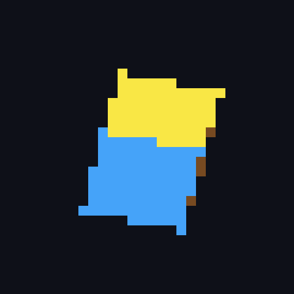</a><br>
<sub>🧊 36 frames, one full turn, 30×30 pixels, 5-bit colour. Every kernel ran inside Qwen3.5-0.8B on an A100 and matched an integer oracle token for token. <a href="docs/qwengl_demo.mp4">mp4</a></sub></p>

---

We took the **qwenTPU** chip ([a TPU compiled into the weights of Qwen3.5](https://github.com/Bobliuuu/qwentpu)) and wrote the layer above it: **a compiler from graphics stages to that chip's programs**.
Each stage is a tiny integer network, `y = clip(relu(x·W + b), 0, 31)`, with 5-bit weights. The weights ride in the prompt, the model emits every output token, and the next stage reads those tokens.

| | 🏁 what you get |
|---|---|
| 🔺 | a **triangle rasteriser** made only of ReLU layers: edge functions, hard coverage, both windings |
| 🧱 | a **real depth buffer**: all 12 triangles drawn, no culling, back faces get overwritten by a branch-free gated write |
| 🎨 | **flat shading**: 5 brightness levels × 6 hues from `light · normal`, computed in the model |
| ✅ | **0 mismatches** over 1.8 M predicted tokens, and one frame generated fully **free-running** |

<p align="center">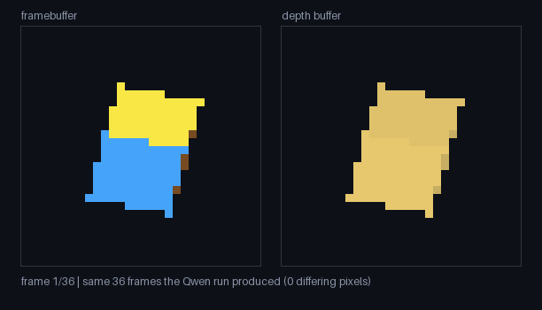<br>
<sub>🧊 colour buffer and depth buffer side by side. Bright = near.</sub></p>

## 🏗️ Architecture

One **kernel** is one **prompt**. The kernel's weights are 1,024 `CELL` tokens, its input is 16 `ACT` tokens, and the model emits the rest.

<p align="center"></p>

<p align="center">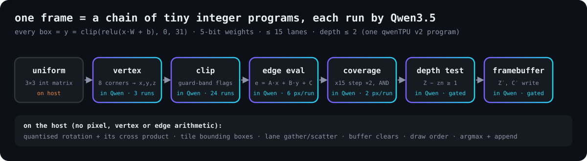</p>

### 🧩 Anatomy of a kernel

<p align="center"></p>

Every stage has this shape and the hardware limits are **asserted when the kernel is built**: 5-bit weights, at most 15 lanes, depth at most 2.
A deeper stage is just two programs back to back.

### 🎟️ What the model actually sees

<p align="center"></p>
<p align="center">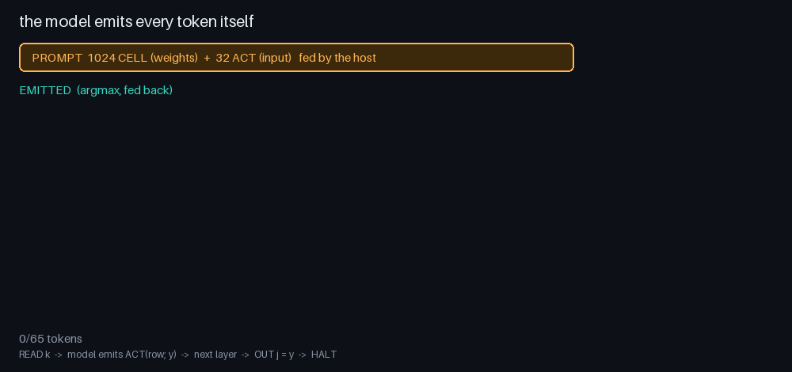<br>
<sub>🎞️ real decoded tokens from a real coverage run. The host fed the 1,056 prompt tokens, the model picked the other 65.</sub></p>

## 🖼️ How a frame is drawn

<p align="center">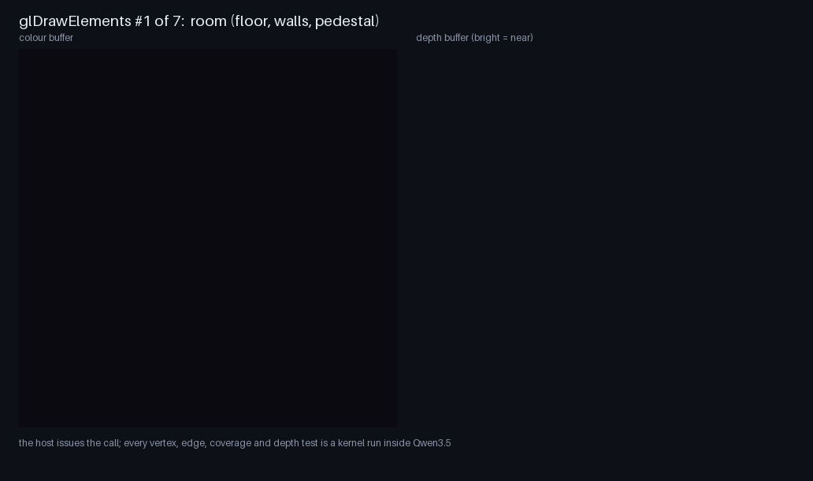</p>
<p align="center"><sub>🎞️ one frame, triangle by triangle. Left to right: the three edge-function outputs, their AND, the depth buffer, the framebuffer. All panels are real kernel outputs.</sub></p>

<p align="center"></p>

### 📐 Edge functions without a multiplier

<p align="center"></p>

The pixel position is the **weight**, the vertex data is the **activation**. The product `Xa·Yb − Xb·Ya` that triangle setup needs is rewritten as a dot with a 3-integer uniform (Binet–Cauchy), so setup costs no multiplier.

<p align="center">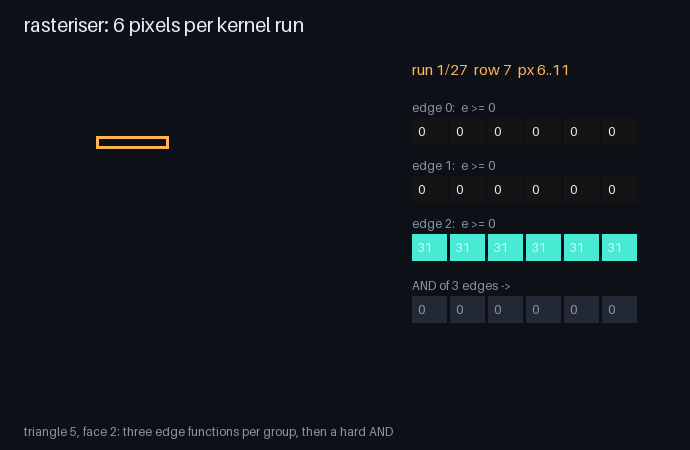<br>
<sub>🎞️ one triangle, 6 pixels per kernel run, 27 runs. Three edge functions, then a hard AND.</sub></p>

### 🪜 Why a ReLU network can draw a hard edge

Weights are 5-bit, so one layer multiplies by at most 15. Two such layers saturate every `e ≥ 0` to exactly 31 and leave every `e < 0` at 0.

<p align="center">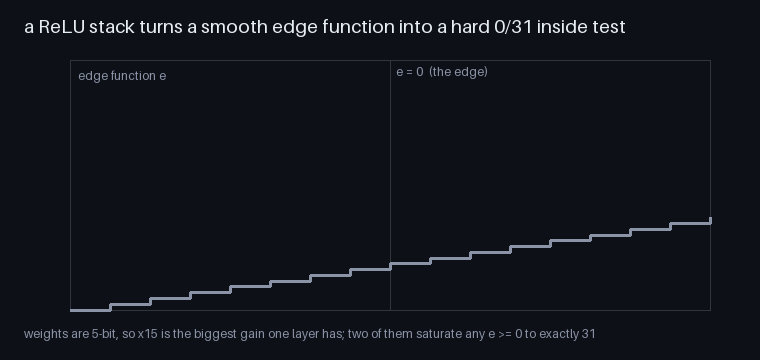</p>

## 🔬 Life of a pixel

Pixel (12, 7) of the demo frame is covered by **four** triangles. The first two win the depth test, the last two are rejected.

<p align="center"></p>
<p align="center">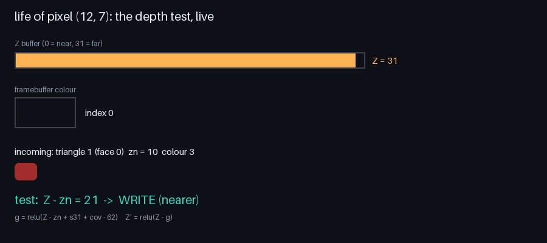</p>

### 🧱 The depth test is four ReLU layers

<p align="center"></p>

No branch, no comparison instruction, no multiplier: a conditional move built from saturating adds.

## 📊 Measured

<p align="center"></p>

| A100, Qwen3.5-0.8B, 30×30, 36 frames | |
|---|---|
| kernel runs (one qwenTPU program each) | **104,940** (27,880 unique, identical runs cached) |
| tokens through the model | **31.2 M**, 1,809,896 predicted positions |
| mismatches, model argmax vs integer oracle | **0** |
| frames identical to the numpy pipeline | **36 / 36**, 0 differing pixels |
| wall time | 812 s (about 23 s per frame, shared GPU) |
| 🆓 one frame, true free-running generation | 2,005 runs (875 unique), 56,747 tokens, **0 mismatches**, 123 s |

Logs are in [`results/`](results/). The numpy pipeline is itself checked bit for bit against an independent integer software rasteriser (`pytest`).

## ⚠️ What is not in the model

<p align="center"></p>

- 🧰 **Uniforms on the host.** The rotation is quantised to a 3×3 integer matrix and its cross product `m` is computed on the host, like a GL normal matrix.
- 🧰 **Binning and data movement on the host.** Bounding boxes from vertex outputs, lane gather and scatter between kernels, buffer clears (Z = 31, colour = 0), draw order. Raster ops whose coverage the model reported as all zero are not launched (predication).
- ✂️ **Clipping is a guard-band check only.** No polygon clipping, no new vertices. The demo cube never triggers it.
- 📏 **Depth is flat per face**, not interpolated: exact for a convex cube, not for general meshes.
- 🗃️ **The framebuffer and depth buffer live in host-held tokens between kernels**, not in model state. Every value in them was produced by the model.
- 🔁 **The 36-frame run is teacher-forced.** Each program's expected continuation is fed and the model's argmax at every position is compared with it (0 mismatches). For a deterministic argmax this is what free-running generation emits, and the numbers passed to the next stage are decoded from the model's predicted tokens. To close the gap, one full frame was also run **free-running** (`--free-run`: the host does only `argmax; append`, expected tokens are never fed): 0 mismatches, framebuffer identical to numpy. The 36-frame run predates the skip of empty raster ops.
- ⚡ **Only the TPU layers run.** Qwen's own muted layers are skipped, bit-identical per qwenTPU's tests.
- 🔬 30×30 pixels, 5-bit colour, orthographic. It is a very small GPU.

## 🚀 Run it

```bash
pip install -e ".[dev]" && pytest -q                     # numpy pipeline vs integer reference
python demo.py --backend numpy --frames 36 --out out/numpy
python make_video.py out/numpy docs/numpy_demo
```

With a GPU, `torch`, `transformers`, [qwentpu](https://github.com/Bobliuuu/qwentpu) on `PYTHONPATH` and a Qwen3.5-0.8B checkpoint:

```bash
QWEN_DIR=/path/to/Qwen3.5-0.8B python run_qwen.py --out out1               # one frame, cross-checked against numpy
QWEN_DIR=/path/to/Qwen3.5-0.8B python run_qwen.py --free-run --out out1    # true autoregressive generation
QWEN_DIR=/path/to/Qwen3.5-0.8B python demo.py --backend qwen --frames 36 --out out/qwen
```

Regenerate the diagrams and animations from real kernel data:

```bash
PYTHONPATH=.:/path/to/qwentpu python tools/collect_data.py   # docs/data.json (pixel journey, decoded tokens)
python docs/tools/gen_svgs.py                                # all SVG diagrams
PYTHONPATH=. python tools/gen_anim.py && PYTHONPATH=. python tools/gen_anim2.py
```

## 🧰 Layout

| path | what |
|---|---|
| `qwengl/kernel.py` | the kernel IR and the hardware limits it enforces (5-bit weights, 15 lanes, depth 2) |
| `qwengl/stages.py` | every pipeline stage as integer layers |
| `qwengl/pipeline.py` | the frame loop: which kernel runs on what, in what order |
| `qwengl/reference.py` | independent integer rasteriser the pipeline must match |
| `qwengl/qwen_backend.py` | runs kernels in a real Qwen3.5 (teacher-forced or free-running) |
| `tools/`, `docs/tools/` | generators for every animation and diagram, driven by real kernel outputs |

## 🙏 Credits

Built on [**qwenTPU**](https://github.com/Bobliuuu/qwentpu) and **Qwen3.5**. Design vocabulary from Qwenputer, QwenPU and TinyTPU. MIT licensed.
